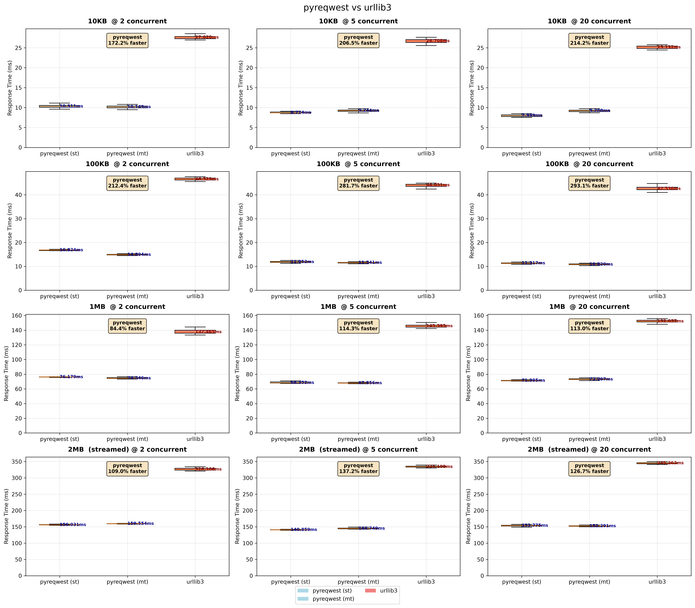
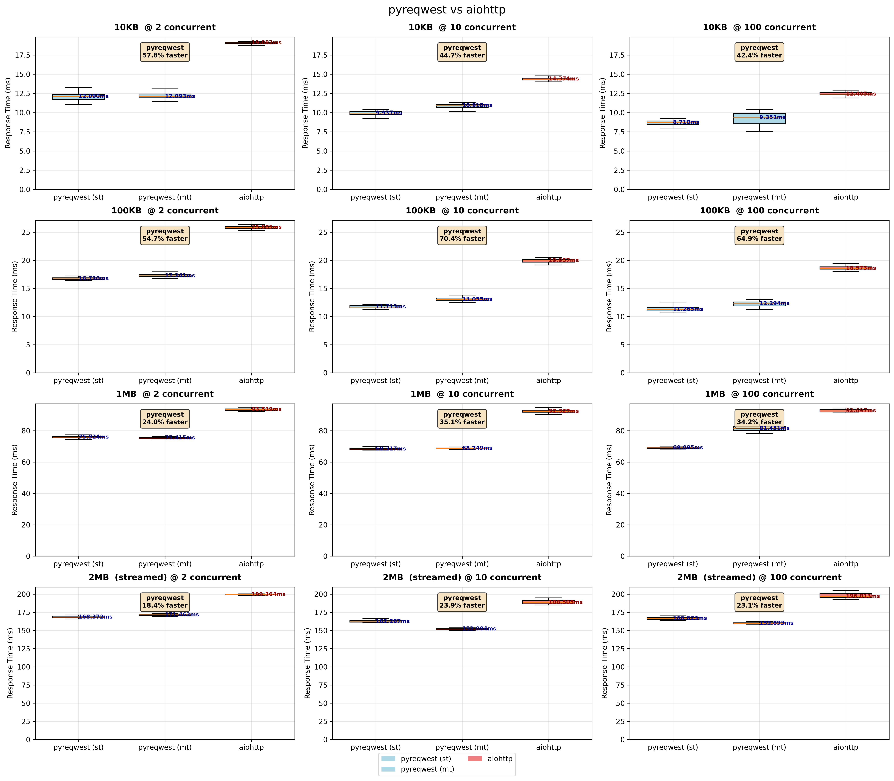
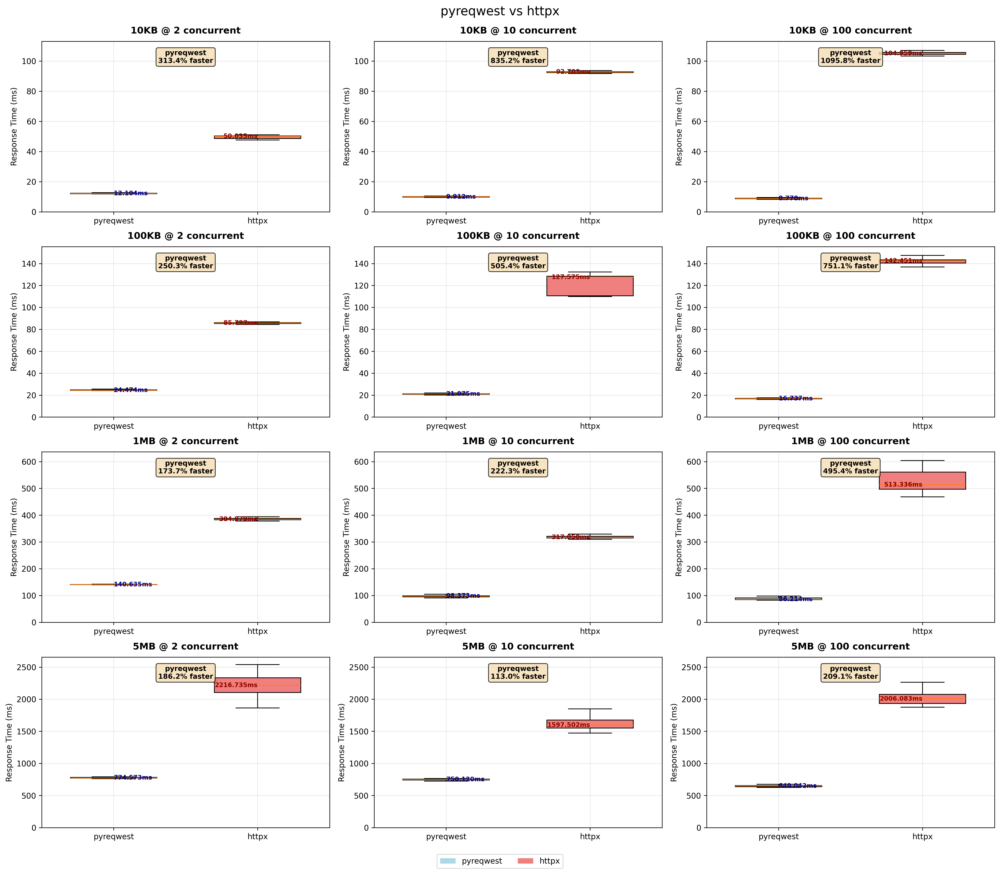
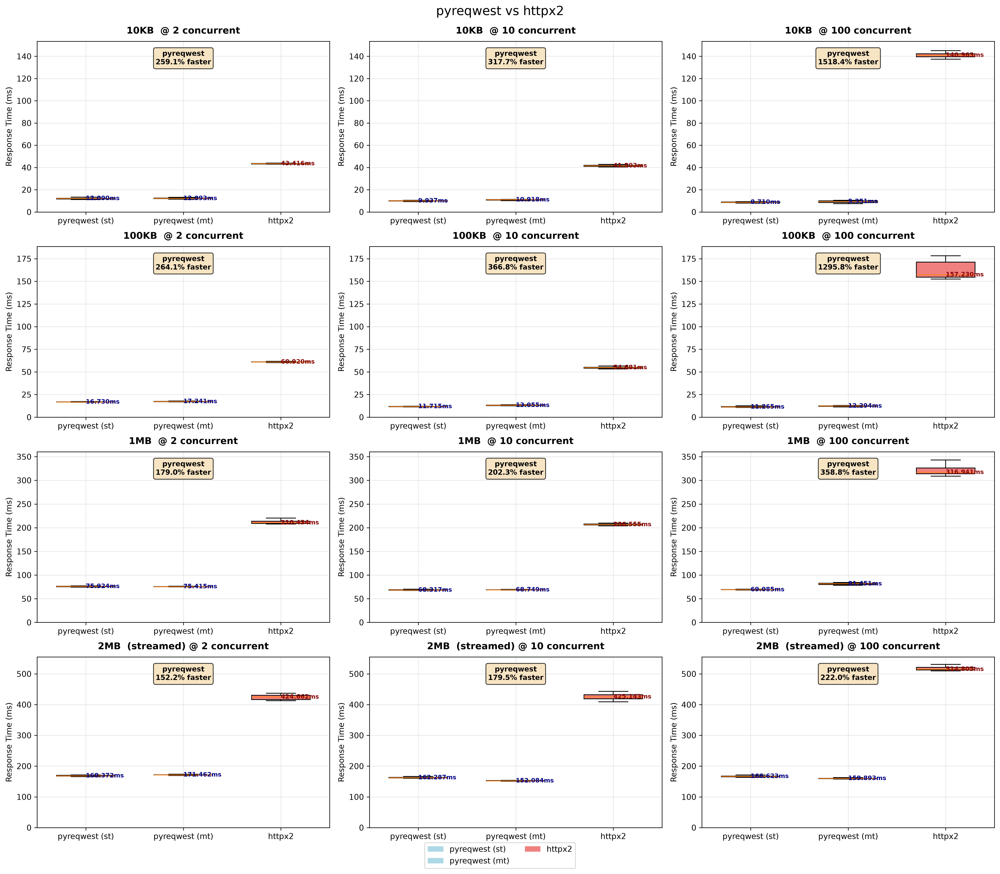
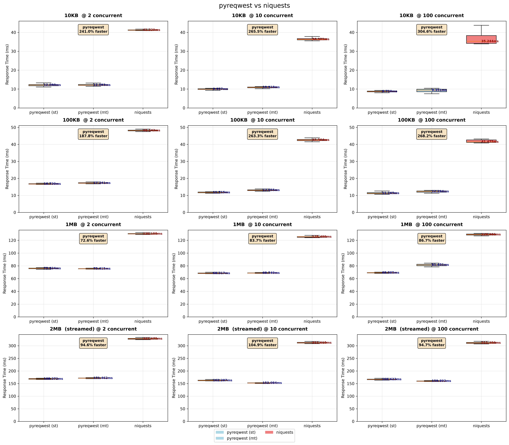
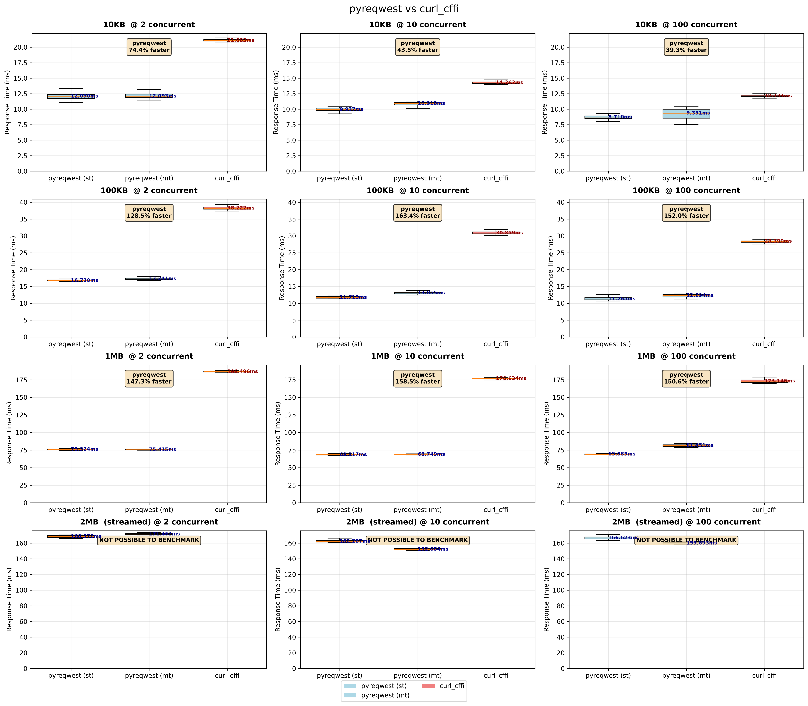

## Latency comparisons

- [urllib3 (sync)](#urllib3)
- [aiohttp (async)](#aiohttp)
- [httpx (async)](#httpx)
- [httpx2 (async)](#httpx2)
- [rnet (async)](#rnet)
- [niquests (async)](#niquests)
- [curl_cffi (async)](#curl_cffi)

In graphs `pyreqwest (st)` uses single-threaded and `pyreqwest (mt)` multi-threaded [runtime](./performance.md#async-runtime).

### Compared to [urllib3](https://github.com/urllib3/urllib3) (sync) <a name="urllib3" id="urllib3"></a>

<p align="center">
    
</p>

### Compared to [aiohttp](https://github.com/aio-libs/aiohttp) (async) <a name="aiohttp" id="aiohttp"></a>

<p align="center">
    
</p>

### Compared to [httpx](https://github.com/encode/httpx) (async) <a name="httpx" id="httpx"></a>

<p align="center">
    
</p>

### Compared to [httpx2](https://github.com/pydantic/httpx2) (async) <a name="httpx2" id="httpx2"></a>

<p align="center">
    
</p>

### Compared to [rnet](https://github.com/0x676e67/rnet) (async) <a name="rnet" id="rnet"></a>

<p align="center">
    
</p>

### Compared to [niquests](https://github.com/jawah/niquests) (async) <a name="niquests" id="niquests"></a>

<p align="center">
    
</p>

### Compared to [curl_cffi](https://github.com/lexiforest/curl_cffi) (async) <a name="curl_cffi" id="curl_cffi"></a>

<p align="center">
    
</p>

---

## GC pressure

| Library (mode)        | Total Collections  | Total Collected  |
|-----------------------|--------------------|------------------|
| pyreqwest (sync, st)  | 6                  | 0                |
| pyreqwest (sync, mt)  | 7                  | 0                |
| pyreqwest (async, st) | 54                 | 0                |
| pyreqwest (async, mt) | 154                | 0                |
| rnet (async)          | 40                 | 0                |
| curl_cffi (async)     | 257                | 120              |
| aiohttp (async)       | 523                | 1184             |
| urllib3 (sync)        | 708                | 822564           |
| httpx (async)         | 772                | 1347560          |
| httpx2 (async)        | 1119               | 28               |
| niquests (async)      | 1976               | 2708557          |

---

## Benchmark

```bash
make bench
```
Benchmarks run against embedded server to minimize any network effects on latency measurements. Python 3.14.9 (CPython) was used.
Connections use HTTP/1.1 with TLS.
Benchmarks were run on Apple M3 Max machine with 36GB RAM (macOS 27.2).
